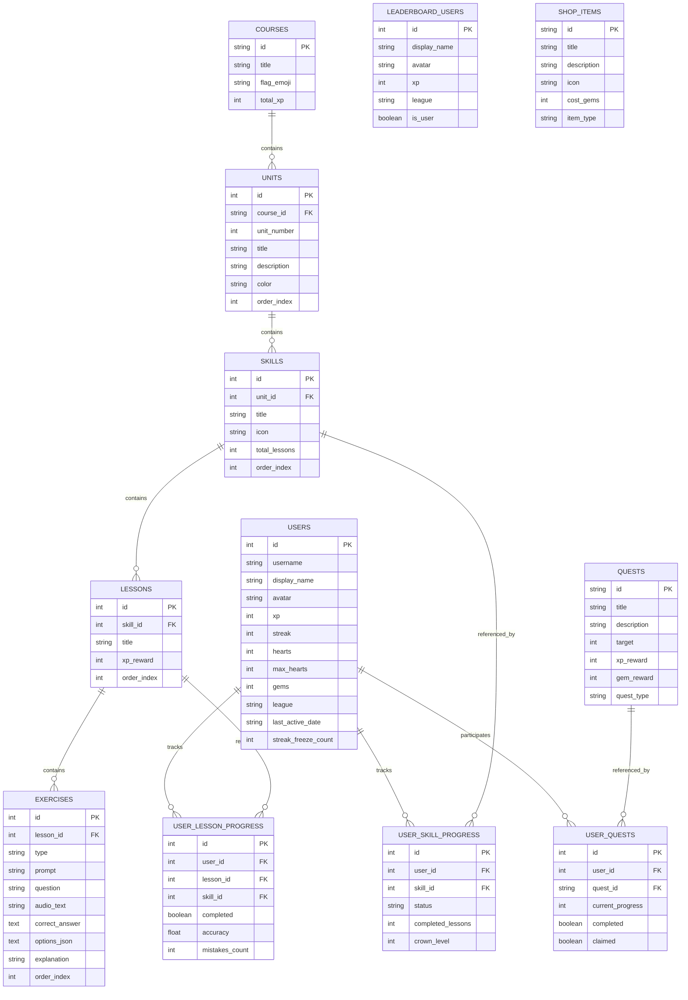

# 🦉 Duolingo Clone — SDE Fullstack Web Application

A fullstack web application clone of **Duolingo** replicating its iconic design system, gamification mechanics, and core lesson workflows. Built with **Next.js (TypeScript)** on the frontend and **Python (FastAPI + SQLAlchemy + SQLite)** on the backend.

---

## 🌟 Key Features

### 1. 🗺️ Learning Path / Skill Tree
- **Serpentine Winding Path**: Authentic zigzag stepping-stone path with units, milestone chests, and unit checkpoints.
- **Unit Theming & Guidebooks**: Color-themed units (Unit 1 Emerald, Unit 2 Azure) with unit headers, descriptions, and popover **Grammar & Phrase Guidebooks**.
- **Tactile 3D Skill Nodes**: Duolingo's iconic 3D push-buttons with SVG lesson progress rings and crown level badges.
- **Animated Duo Mascot**: Cheerful SVG mascot that hovers over the active skill stone with speech bubbles encouraging the learner.
- **Top Stats Bar**: Live streak flame counter, gem count, hearts counter, Spanish course selector, and sound effects toggle.

### 2. 🎮 Interactive Lesson Player (The Core Loop)
- **5 Varied Exercise Types**:
  1. **Multiple Choice**: Image & emoji cards with Spanish audio playback and hotkeys (`1`, `2`, `3`).
  2. **Translate (Word Bank)**: Interactive tap-to-place and tap-to-remove word bank tiles.
  3. **Match Pairs**: Dual-column vocabulary matching with sound effects, green matches, and error shake animations.
  4. **Fill in the Blank**: Inline sentence placeholder with responsive choice chips.
  5. **Type the Answer**: Text input with accent character toolbar (`á`, `é`, `í`, `ó`, `ú`, `ñ`, `¿`, `¡`) and `Enter` key submission.
- **Native Text-to-Speech (TTS)**: Powered by the Web Speech API (`SpeechSynthesis`) with Spanish accent pronunciation.
- **Web Audio Sound Effects**: Synthesized Duolingo chimes (*ba-ding!* correct chime, double-boop wrong buzzer, tap clicks, fanfare chords).
- **Signature Sliding Feedback Bar**: Slide-up bottom sheet with green success state (*"Nicely done!"*), red mistake state with correct solution, and `Enter` key shortcut.
- **Hearts System**: 5 hearts capacity; mistakes deduct hearts with cracked animations; out-of-hearts modal with options to practice or refill.
- **Celebratory Victory Screen**: Confetti fireworks burst (`canvas-confetti`), fanfare audio, XP counters, accuracy rating, and streak animation.

### 3. 🏆 Gamification & Progress
- **Daily Streak Mechanics**: Tracks consecutive daily activity, last active date, and streak freeze protections.
- **Competitive Leaderboard (Silver League)**: Ranked league table featuring promotion zones (top 3 advance with medals), demotion zones, and user rank tracking.
- **Daily Quests & Challenges**: Progress bars for daily XP goals, lesson completion, and accuracy challenges with claimable gem & XP rewards.
- **Shop & Power-ups**: Shop where learners can spend gems on Heart Refills, Streak Freezes, Double or Nothing wagers, and Duo outfits.
- **Practice Mode**: Review exercise sessions that regenerate hearts (+1 heart restored) and award XP.

### 4. 🧪 Built-in Evaluator Simulation Hub
- Located on the `/profile` and `/shop` pages:
  - **⚡ Advance Day (+1 Streak)**: Instantly simulates the next day to verify streak incrementation.
  - **❄️ Miss Day**: Simulates a missed day to verify Streak Freeze deduction or streak resets.
  - **💎 +200 Test Gems**: Grants demo gems to easily test shop purchases without grinding.
  - **🔄 Reset Course Progress**: Re-locks skills and resets progress for demoing fresh user onboarding.

---

## 🏗️ Architecture & Tech Stack

```
duolingo-clone/
├── backend/
│   ├── app/
│   │   ├── models.py          # SQLAlchemy SQLite ORM models
│   │   ├── schemas.py         # Pydantic schemas for request/response validation
│   │   ├── database.py        # Database connection & session setup
│   │   ├── seed_data.py       # Seed script (Course, Units, Skills, Lessons, Exercises, Quests)
│   │   ├── routers/
│   │   │   ├── course.py      # /api/courses & /api/courses/{id}/path
│   │   │   ├── lesson.py      # /api/lessons/{id} & /api/lessons/{id}/complete
│   │   │   ├── user.py        # /api/user, /api/user/simulate-day, /api/user/refill-hearts
│   │   │   ├── leaderboard.py # /api/leaderboard rankings
│   │   │   ├── quests.py      # /api/quests & /api/quests/{id}/claim
│   │   │   └── shop.py        # /api/shop & /api/shop/buy
│   │   └── main.py            # FastAPI entry point with CORS & Lifespan auto-seed
│   ├── run.py                 # Runner script for uvicorn server
│   └── requirements.txt       # Python backend dependencies
└── frontend/
    ├── src/
    │   ├── app/
    │   │   ├── page.tsx            # Home Learning Path (Units, Skills, Serpentine path)
    │   │   ├── lesson/[id]/page.tsx# Immersive fullscreen Lesson Player
    │   │   ├── practice/page.tsx   # Practice mode to restore hearts
    │   │   ├── leaderboard/page.tsx# Silver League standings & promotion zone
    │   │   ├── quests/page.tsx     # Daily Quests & badge challenge
    │   │   ├── shop/page.tsx       # Gem store with power-ups & test gem buttons
    │   │   └── profile/page.tsx    # Learner profile, avatar picker & Simulation Hub
    │   ├── components/
    │   │   ├── DuoMascot.tsx       # Animated SVG Mascot (happy, celebrating, sad, thinking, tuxedo)
    │   │   ├── Sidebar.tsx         # Iconic desktop navigation & mobile bottom bar
    │   │   ├── TopBar.tsx          # Top bar with streak, hearts, gems & audio toggle
    │   │   ├── RightRail.tsx       # Desktop right rail (Super Duolingo, Quests, League teaser)
    │   │   ├── PathUnit.tsx        # Unit headers, serpentine path layout, milestone chest
    │   │   ├── SkillNode.tsx       # 3D tactile skill button with SVG progress ring
    │   │   ├── LessonPlayer.tsx    # Full lesson player with bottom feedback bar
    │   │   └── exercises/          # MultipleChoice, TranslateWordBank, MatchPairs, FillBlank, TypeAnswer
    │   ├── lib/
    │   │   ├── api.ts              # API client communicating with FastAPI
    │   │   └── sound.ts            # Web Audio API sound synthesizer & Spanish TTS
    │   └── types/index.ts          # TypeScript type definitions
    └── package.json
```

---

## 🗄️ Database Design & Schema

The application uses an SQLite database (`duolingo.db`) managed via SQLAlchemy ORM.

### Entity Relationship Diagram



---

## 📡 REST API Overview

| Method | Endpoint | Description |
|---|---|---|
| `GET` | `/api/courses` | Lists all available courses |
| `GET` | `/api/courses/{id}/path` | Returns units, skills, crowns, and user progress for the learning path |
| `GET` | `/api/lessons/{id}` | Fetches lesson exercises sequence |
| `POST` | `/api/lessons/{id}/complete` | Submits lesson results, awards XP, computes streak, updates quests & crowns |
| `POST` | `/api/lessons/practice` | Practice session completing review, restores +1 Heart and gives +10 XP |
| `GET` | `/api/user` | Retrieves current learner profile with streak, hearts, and gems |
| `PATCH` | `/api/user` | Updates avatar or display name |
| `POST` | `/api/user/refill-hearts` | Refills hearts to maximum capacity (5/5) |
| `POST` | `/api/user/simulate-day` | Simulates advancing 1 day (streak increment) or missing 1 day (streak freeze) |
| `POST` | `/api/user/reset-progress` | Resets user progress back to clean state for fresh evaluations |
| `GET` | `/api/leaderboard` | Ranked Silver League competitors with live user rank |
| `GET` | `/api/quests` | Daily quests with user progress and claim status |
| `POST` | `/api/quests/{id}/claim` | Claims reward for completed quest (+gems and +XP) |
| `GET` | `/api/shop` | Lists power-ups and cosmetic items in shop |
| `POST` | `/api/shop/buy` | Purchases an item with gems (deducts gems, applies heart refill/freeze) |

---

## 🚀 Setup & Installation Instructions

### Prerequisites
- **Node.js** (v18 or newer) & **npm**
- **Python** (v3.10 or newer) & **pip**

### 1. Backend Setup (FastAPI)
```bash
cd backend

# Install dependencies
pip install -r requirements.txt

# Run the backend server (starts on http://localhost:8000)
python run.py
```
> *On first run, the SQLite database (`duolingo.db`) is automatically created and seeded with Spanish Course Unit 1 & Unit 2, 5 Skills, 9 Lessons, 45 Exercises, Quests, and Leaderboard data.*

### 2. Frontend Setup (Next.js)
```bash
cd frontend

# Install dependencies
npm install

# Start development server (starts on http://localhost:3000)
npm run dev
```

### 3. Open Application
Open your browser and navigate to:
**[http://localhost:3000](http://localhost:3000)**

API interactive Swagger documentation is available at:
**[http://localhost:8000/docs](http://localhost:8000/docs)**

---

## 🧪 Testing the Core Workflows

1. **Lesson Gameplay**:
   - On the home page, click **START HERE!** on Skill 1 (Basics 1) or Skill 2 (Greetings).
   - Experience all 5 exercise types (Multiple Choice, Word Bank Translate, Match Pairs, Fill Blank, Type Answer).
   - Notice the sound effects (*ba-ding!* on correct, *uh-oh!* on wrong, *pop!* on word tiles).
   - Click the blue speaker button to hear native Spanish speech synthesis.
   - Intentionally enter an incorrect answer to observe heart deduction and exercise re-queuing.
   - Complete the lesson to experience the confetti fireworks, accuracy stats, and streak progression.

2. **Gamification Testing**:
   - Check the **Top Bar** to see XP increase and hearts reflect changes.
   - Visit the **Leaderboard** (`/leaderboard`) to see your position dynamically change based on your XP.
   - Visit **Quests** (`/quests`) and click **CLAIM REWARD** once your progress is complete.
   - Visit **Shop** (`/shop`), click **+200 Test Gems**, and purchase a **Streak Freeze** or **Refill Hearts**.

3. **Streak & State Simulation**:
   - Navigate to `/profile`.
   - Click **⚡ Next Day (+1 Streak)**: notice your streak increment and date update.
   - Click **❄️ Miss Day**: test how your streak freeze protects your count.
   - Click **Reset All Progress**: reset back to Lesson 1 if you want to start completely fresh.

---

## 📦 Deployment Instructions

- **Frontend (Vercel)**:
  1. Push the code to a GitHub repository.
  2. Import the repository in [Vercel](https://vercel.com) with Root Directory set to `frontend`.
  3. Set Environment Variable: `NEXT_PUBLIC_API_URL` to your deployed backend URL.
- **Backend (Render / Railway / Fly.io)**:
  1. Create a Python Web Service with Root Directory set to `backend`.
  2. Build Command: `pip install -r requirements.txt`.
  3. Start Command: `uvicorn app.main:app --host 0.0.0.0 --port $PORT`.

---

## 🛡️ License
Built for the SDE Fullstack Assignment evaluation. All rights reserved.
